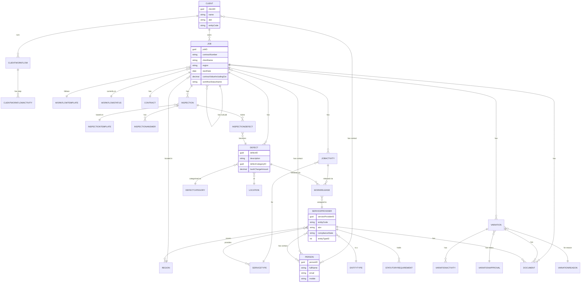

# osc-api MCP server (registered as `osc-api-prod`)

A local (stdio) MCP server that bridges Claude Code to the **Companion Systems
OSC API** (OSCAPI) of the **production** OnSite Companion, the one staff use. It
gives skills and sessions a small set of tools to query OSC data and to change
it only through a confirmation gate: the person sees each change in plain words,
with the values it overwrites, and nothing is sent without their yes.

This is **code only**. No credentials or server names live here; they are
supplied through `OSC_*` settings in the git-ignored `production.env`. The dev
copy this server used until 13 Oct 2026 (frozen 21 Aug 2026) is no longer a
supported target.

## OSC object model (what you can query)

The entities OSC exposes and how they relate, derived from the API's route
hierarchy. **Job is the hub**: it owns its variations, defects, inspections,
workflow activities, contacts and documents. Service providers (trades) connect
to work through **work releases**. This is what the tools below reach.



Cardinality reads left-to-right: `||--o{` is one-to-many, `}o--||`
many-to-one, `}o--o{` many-to-many, `||--||` one-to-one.

**Cross-cutting and reference data** (not drawn, to keep the diagram legible):
- **Alerts** and **Messages** attach polymorphically to jobs, job activities,
  defects and client-workflow activities; **Documents** attach to jobs,
  variations, defects, messages, work releases and service providers.
- **Users** (with roles), **Orders**, **StoppageRequests**, **ClientLogs**, and
  the **Liink** / **MobileApp** channels are additional top-level capabilities.
- **Lookups**: Region, Service, ServiceType, DocumentType, DefectCategory,
  Location, StatutoryRequirement, EntityType, WorkflowStatus, WorkflowTemplate,
  VariationReason, VariationApproval, plus the `Miscellaneous/*` enums.

## Tools

| Tool | Kind | What it does |
|---|---|---|
| `osc_token_info` | read | Environment, granted scope, write switch and the live-data check. Start here. |
| `osc_list_endpoints` | read | List endpoints from the OpenAPI spec; filter by `contains` / `method`. |
| `osc_describe_endpoint` | read | Complete parameters, request/response schemas and their transitive local references for one path. |
| `osc_get` | read | GET any endpoint. Supports OData `query` params and body-filter GETs (e.g. `/api/Jobs`) via `odata_filter`. |
| `osc_prepare_write` | read | Checks one change and words its confirmation; sends nothing. See [Write safety](#write-safety-human-in-the-loop). |
| `osc_prepare_changes` | read | The same for several changes to one job (an intake stage): one confirmation for all of them; sends nothing. |
| `osc_cancel_write` | read | Discards a prepared change or batch. |
| `osc_confirm_write` | **write** | Sends a prepared change or batch on the person's plain yes, then reads each change back. The only tool that changes OSC. |

The read tools cover all 148 OSCAPI endpoints generically (the spec is loaded at
run time), so no per-endpoint code needs maintaining when the API version moves.

## Using it — just ask in plain English

Once the server is registered (see below) and your session has started, you don't
call the tools by hand. Ask Claude Code in plain English and it picks the right
tool. Read requests run without a prompt; every change is shown to you first
and waits for your yes.

| Ask in plain English | Tool(s) it uses |
|---|---|
| "Show me the last 5 jobs in OSC" | `osc_get` on `/api/Jobs` |
| "Find the client called Monterea and list their contacts" | `osc_get` on `/api/Clients` + `/api/Clients/Contacts` |
| "What variations exist for job 24084?" | `osc_get` on `/api/Jobs/{JobID}/Variations` |
| "List all the OSC endpoints to do with inspections" | `osc_list_endpoints` |
| "Get one defect record so I can see the shape" | `osc_get` on `/api/Defects` |

These are starting points, not a fixed menu. Anything the API exposes is
reachable the same way. Check what's registered and connected with `/mcp`.

## Actions you can do via the MCP

**`osc_get`** performs any of the **101 read** operations below.
`osc_list_endpoints` and `osc_describe_endpoint` discover and explain any of
them. The catalogue also lists the API's **76 write** operations for
reference, but Claude can make **only the 14 contract-intake changes** and
**the Permit Officer's building-approval changes** (see
[Write safety](#write-safety-human-in-the-loop)); the rest stay a person's job
in OnSite Companion.

> **Note — some writes are outward-facing or irreversible.** `EmailWorkReleases`
> actually **sends an email** to a service provider; `Complete`, `NotApplicable`
> and the `Delete` operations change records in ways that are hard to undo.
> Email, delete, not-applicable and re-template operations are outside the
> approved list, and an activity completion needs the person's yes like any
> other change.

### Jobs
- **Read** — list/filter jobs; get a job; its contacts, documents, custom fields (+ schemas), alerts, messages, locations, defects (+ defect locations), inspections, variations, sub-job relationships, document types in use, and workflow statuses/templates.
- **Write** — create a job; update a job; update its contract; append a workflow template; add/update/delete a job contact; add documents; create a sub-job; create a defect, inspection (from a template), variation, alert or message on the job.

### Job activities (workflow steps)
- **Read** — list activities; completion questions and answer states; assignable service providers; a work-release default + available attachments; alerts; messages.
- **Write** — update an activity; set / confirm the booked start date; **complete** an activity; mark **not applicable**; record a completion answer; create a work release; **send an email work release**; create an alert or message.

### Variations
- **Read** — a job's variations; variation activities; approvals; reasons; documents.
- **Write** — create a variation on a job; update a variation; delete a variation.

### Defects
- **Read** — list defects; a job's defects; categories (+ defaults); assignable service providers; a work-release default + attachments + email template; alerts; messages.
- **Write** — create a defect; update a defect; auto-assign a service provider; set / confirm the booked start date; **complete**; mark **not applicable**; create a work release; **send an email work release**; create an alert or message.

### Inspections
- **Read** — list inspections and templates; a job's inspections; answers; inspection defects; completion defects (a preview of what completing will create).
- **Write** — create an inspection from a template; update an answer; **complete** an inspection; create/update/delete an inspection defect; remove documents from an answer or defect.

### Clients
- **Read** — list clients and all client contacts; get a client; client workflows and their activities.
- **Write** — create a client; update a client; add/update/delete a client contact; create an alert or message on a client-workflow activity; post client-side logs.

### Persons (individuals)
- **Read** — list persons; custom fields (+ schemas); get a person.
- **Write** — create, update, or delete a person.

### Service providers (trades)
- **Read** — list providers and all their contacts; custom fields (+ schemas); entity types; regions; service types; statutory requirements; a provider's defect / job-activity work-release contacts; providers for a given service type.
- **Write** — create a provider; update a provider; add/update/delete a contact; add a document; create/update/delete a statutory requirement.

### Service types & services
- **Read** — list service types and services; providers for a service type.
- **Write** — create or update a service type.

### Orders
- **Read** — list orders; download an order's file.
- **Write** — create, update, or delete an order.

### Documents, alerts & messages (cross-cutting)
- **Read** — download a document file; list job / variation / defect / message / work-release / alert documents; alert recipients; per-parent alerts and messages.
- **Write** — attach documents (to jobs, service providers); reversion a document; create alerts/messages on jobs, activities, defects and client-workflow activities; create/update an alert recipient; reply to a message.

### Email accounts, stoppages, work releases
- **Read** — email accounts + providers; stoppage reasons; work-release documents, defaults and attachments.
- **Write** — create/update/delete an email account; create a stoppage request; create a work release; **send an email work release**.

### Reference & lookup data (read-only)
Regions, locations, statutory requirements, document types, defect categories, workflow statuses/templates, variation reasons/approvals, users (+ roles), the `Miscellaneous/*` enums, Liink lookups, and the read-only MobileApp job/workflow/message feeds.

### Auth / diagnostics
`osc_token_info` shows the environment, the credential's granted scope and
token expiry, the write switch, and `live_check` (the newest job's date).

## Write safety (human-in-the-loop)

This server writes to the **production** OnSite Companion that staff work from
(owner approval, 13 Oct 2026). There is no direct write tool: every change
goes through the gate in [`osc_mcp/gate.py`](osc_mcp/gate.py), in two steps
with the person's reply between them.

### 1. `osc_prepare_write` (reads only, sends nothing)

```text
osc_prepare_write(
  method="PATCH",
  path="/api/Jobs/<jobID>",
  job_id="<jobID>",
  body={"siteAddress": {"suburb": "BOX HILL"}}
)
```

It refuses, with the reason in plain words:

- anything the asking workflow may not change (`WORKFLOWS` in `gate.py`).
  `workflow="intake"` (the default) has the **14 contract-intake changes**:
  create client, person or job; update client, person or job; add or update a
  client or job contact; complete an activity; answer an activity question;
  add a job or activity message. `workflow="permit-officer"` has only:
  complete one of ten building-approval activities, and add a job or
  activity message, on NSW jobs in `3. Pre-Construction` (or `20. Test Job`),
  with the extra checks in `job-roles/permit-officer/workflows/osc-updates.md`
  (the step before done, Sydney-time dates, no completion questions, a `note`
  on every tick). Every DELETE, every
  endpoint that emails (`EmailWorkReleases`) or re-templates
  (`AddWorkflowTemplate`), `/Contract`, and the rest stay a person's job in OSC;
- a record that is not tied to `job_id`: the job itself, its client, a
  contact on the job or its client, or one of the workflow's activities on the job (the intake's four: Initial Contact, Follow Up Initial Contact, Create Job within Databuild, Receive EOI Approval to Proceed from Marketer; the Permit Officer's ten), checked by name because activity numbers differ between workflow templates;
- a target that is missing, not a single GUID, or matches more than one
  record;
- a field the record does not have, or a protected one: contract price
  (DataBuild only), contract number (OSC generates it), region of an existing
  job, DataBuild client code;
- a completed activity, an existing contact link, or a change OSC already
  holds (in a batch these are left out and listed instead of blocking);
- a stale copy: the newest job in OSC is more than `OSC_STALE_AFTER_DAYS`
  (30) days old.

Otherwise it reads the current record and returns:

- `confirmation_text`: the job, each change as *now X, will be Y* (clears and
  overwrites spelled out), a note when the client or person is shared with
  other jobs, and duplicate warnings: every job on the same lot **and suburb**
  (all jobs on the lot number are read, since lot numbers repeat across
  estates; the count elsewhere is a note), a client with the same name in any
  case or the same words in another order, a person with the same name, email
  or mobile, and a message with the same subject;
- `would_send`: the smallest request that makes exactly those changes. Values
  OSC already holds are dropped. Custom fields go as the record's full set with
  the changes merged in, so none is dropped whether OSC merges or replaces the
  list. A PUT answer carries the current note when only the state changes;
- `confirmation_code`: six characters, valid for `OSC_APPROVAL_MINUTES` (30).

With writes switched off it still returns the confirmation, but no code.

### 2. The person reads the confirmation and replies

### 3. `osc_confirm_write(confirmation_code, user_reply)` (the only write)

- A plain yes ("yes", "ok", "go ahead", "是", "确认" ...) goes ahead. "No"
  cancels. Anything else, such as "yes but change the lot", sends nothing.
- The target is read again. If the record or the request differs from what
  was confirmed, nothing is sent and a new confirmation and code come back.
- The stored request is sent, not a new one. A code works once, and a newer
  check of the same target replaces it.
- The record is read back: `state: verified` only when every confirmed field
  took and nothing else on the record changed. Otherwise the result names the
  fields that did not take or changed unexpectedly. A dropped connection is
  `sent_unverified`: look in OSC before trying again.

`osc_cancel_write(confirmation_code)` discards a prepared change.

A message is read back from OSC itself: the new message must be listed where
it was posted, and its attachments are counted through
`/api/Messages/Documents` (production lists messages without their documents).

### Batches: one confirmation per stage

`osc_prepare_changes(job_id, changes)` takes the changes of one stage in
order, each `{method, path, body}` or `{method, path, form, files}`, and
gives every one the checks above. The person reads one confirmation and one
plain yes sends them all, so a contract intake asks three times (new client
and job; the job's set-up; DataBuild done) instead of once per field.

- Anything that cannot go ahead blocks the whole batch; anything OSC already
  holds is left out and listed.
- Two changes to the same record are refused: put them into one.
- A later change can use an ID an earlier one creates: `{{N.clientID}}` as a
  new job's `clientID`, `{{N.personID}}` as the person in a contact-link path.
  `job_id` is empty only for a batch that creates a new intake's client,
  people and job.
- On the yes, every change is checked again before the first is sent. Each
  later change is planned again just before it goes; the batch stops at the
  first that fails or no longer matches what was confirmed (`state: stopped`,
  `failed` or `sent_unverified`), the earlier ones stay done and read back,
  and a `stopped` result carries a new confirmation for the rest.

On top of the gate, the host keeps `mcp__osc-api-prod__osc_confirm_write` on
`ask` in [`.claude/settings.json`](../../../.claude/settings.json), and the master
switch below must be on.

### Message attachments

Request-email messages are multipart: `form` for `Subject`, `Body`,
`Documents[n].description`; `files` for `Documents[n].file` mapped to an
absolute path on the MCP server's machine. Every file must sit under an
**upload root** (`OSC_UPLOAD_ROOTS`, `;`-separated absolute directories;
default the checkout's git-ignored `runtime\` folder), so a stray settings or
key file can never be attached to a job. The preview checks the file (exists,
under a root, size) without opening it. The file is opened only when the
change is sent, streamed through httpx and closed afterwards.

### Contract workflow integration

`/new-contract-template` uses this MCP for issue #34's OSC intake steps before
the existing document pipeline. The
[execution reference](../../../.claude/skills/new-contract-template/references/osc-new-contract.md)
maps the Word fields to endpoints and runtime custom-field labels, and defines
duplicate checks, recovery and read-back. DataBuild is excluded.

`osc_describe_endpoint` returns `request_body`, `response_details`, full
parameter metadata and `referenced_definitions` (literal `$ref` to
definition). `unresolved_references` lists missing or external references. No
external reference is fetched.

### Turning writes on or off

`OSC_ENABLE_WRITES` reaches the server from two places, and the order matters:

1. the `env` block of the committed `.mcp.json` at the repo root — the MCP
   host passes it to the server process as a real environment variable;
2. the git-ignored `production.env` beside this package — read by
   `osc_mcp.config` only for variables the real environment does **not**
   already set.

So the `.mcp.json` value always wins. (On 14 Sep 2026 the flag was flipped in
`.env.example`, which nothing reads, and every session until 24 Sep 2026 kept
reporting `enable_writes: false`.)

To change it: edit `.mcp.json` on a branch, land it through a PR, pull on the
server, then **open a new Claude Code session in the repo folder**. The server
is started per session, so the new session is the restart. `osc_token_info`
reports the effective value and its origin:

```
"enable_writes": true, "enable_writes_source": "env"      # from .mcp.json / real env
"enable_writes": false, "enable_writes_source": "dotenv"  # from production.env - .mcp.json not applied
"enable_writes": false, "enable_writes_source": "default" # nowhere set
```

## Configuration

`OSC_ENVIRONMENT` must be `production` (the only value accepted; the dev copy
was retired 13 Oct 2026). Everything else comes from `production.env` beside
this README (template: [`production.env.example`](production.env.example)),
or from `OSC_ENV_FILE` if set. The old `.env` is never read.

| Var | Required | Purpose |
|---|---|---|
| `OSC_BASE_URL` | yes | Production API base, e.g. `https://<host>:<port>`. |
| `OSC_CLIENT_ID` / `OSC_CLIENT_SECRET` | yes | Production client-credentials pair. |
| `OSC_SWAGGER_URL` | no | OpenAPI spec URL for introspection; must match the API version. |
| `OSC_SCOPES` | no | Space-separated scopes; the intake needs `Basic WorkReleasingAndCompletion`. |
| `OSC_VERIFY_TLS` | no | Default `true`. `false` only if IT confirms an internal certificate. |
| `OSC_ENABLE_WRITES` | no | Master write switch; default `false`. Set in the committed `.mcp.json` `env` block, which overrides `production.env`. |
| `OSC_TIMEOUT` | no | Per-request timeout (seconds), default 30 (`.mcp.json` sets 120). |
| `OSC_UPLOAD_ROOTS` | no | `;`-separated absolute directories an attachment may be read from; default the checkout's git-ignored `runtime\` folder. |
| `OSC_LOG_ROOT` | no | Absolute directory for the write logs (`<root>\<role>\logs\osc-writes.jsonl`, one line per answered confirmation with the reply as typed); default the checkout's git-ignored `runtime\` folder. |
| `OSC_STALE_AFTER_DAYS` | no | Writes refused when the newest job is older than this; default 30. |
| `OSC_APPROVAL_MINUTES` | no | Life of a confirmation code; default 30. |
| `OSC_API_VERSION` | no | Sent as the `api-version` header on every call, the token request included; default `7.3`. The production API answers HTTP 400 ("The 'api-version' header must be included") without it. The retired dev install never asked for it. |

The tools never show the host: `osc_token_info` reports `target`, a short hash
of the base URL, and httpx request logging is kept at warning level.

## Install & register (Windows server, `pwsh`)

The server is **registered at project scope** as `osc-api-prod` by the
committed [`.mcp.json`](../../../.mcp.json) at the repo root, pre-approved via
`enabledMcpjsonServers` in `.claude/settings.json`, so every session started
in this repo sees it and there is no `claude mcp add` to run. Details and
history in [docs/mcp-servers.md](../../../docs/mcp-servers.md).

A fresh checkout needs only the two git-ignored pieces the registration
points at:

```powershell
# 1. Create the environment and install (run once, and after dependency changes)
Set-Location "Z:\CLAUDE CODE\transpire-claude-code\shared\mcp\osc-api"
python -m venv .venv          # or `uv venv` where uv is installed
.\.venv\Scripts\python.exe -m pip install -e .

# 2. Create production.env: the script asks for the address, spec URL, client ID
#    and secret (typed hidden), writes the file from production.env.example and
#    runs the read-only selftest. Values come from the company password store -
#    never a doc, commit, issue or chat.
.\new-production-env.ps1 -CheckJob <contract number>

# 3. The registration itself
claude mcp list   # "Pending approval" only means this account hasn't accepted
                  # the workspace trust dialog yet; sessions still load it
```

Then in an interactive session, run `/mcp` and check `osc-api-prod` is
connected, and try `osc_token_info`: `environment` is `production` and
`live_check.live` is true.

## Tests (no MCP host, no network)

```bash
python -m unittest discover -s tests -v
```

Run from this folder with the venv python. `tests/fake_osc.py` is a stateful
stand-in for OSC (synthetic data; PATCH keeps omitted fields, and replaces the
custom-field list whole, the worst case for losing data).
`tests/test_write_gate.py` covers the gate end to end: the confirmation's
wording and current values, only approved fields sent and everything else
kept, cancel, no reply, unclear replies, expired and reused codes, re-confirming
when the record or request changes, wrong-job and ambiguous targets, refused
routes and protected fields, the stale-copy check, attachments and send
failures, and new records read back whatever OSC's answer to the create
looks like (its ID field in any case, the ID alone, a Location header, or
nothing - then the one new record the plan's duplicate search finds; two
new matches, or a job with no lot number, stay unverified). That last one
is from the first live intake (job 26059, 23 Oct 2026): production's answers
named nothing the gate could read, so each new client, person and job read
back as unverified and stopped its stage - five confirmations, not three.
`tests/test_permit_officer.py` covers the Permit Officer workflow:
its own allow-list, NSW pre-construction jobs only, the step before, Sydney-time
dates (no time-zone database on the server), completion questions, warnings
inside the one confirmation, a batch re-asked under the same workflow, and the
write log. `tests/test_contract_support.py` covers spec introspection and
configuration.

Live acceptance still needs an agreed job on production: the tests do not
prove contract-number generation or OSC's own validation on creates.

`python -m osc_mcp.selftest [contract number]` runs read-only calls against
production: environment, scope, the live-data check, the intake lookups and,
given a contract number, that job's identity.
